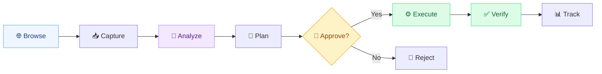
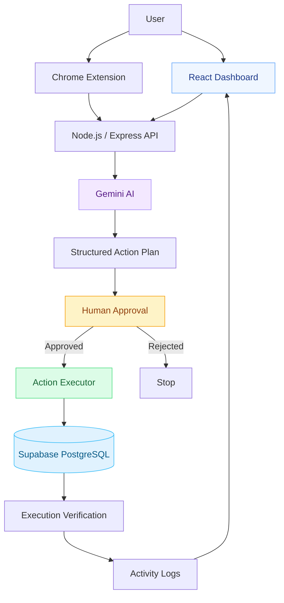
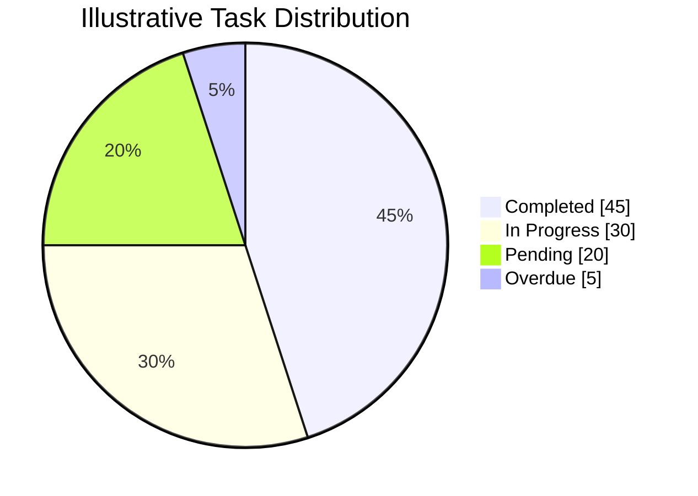
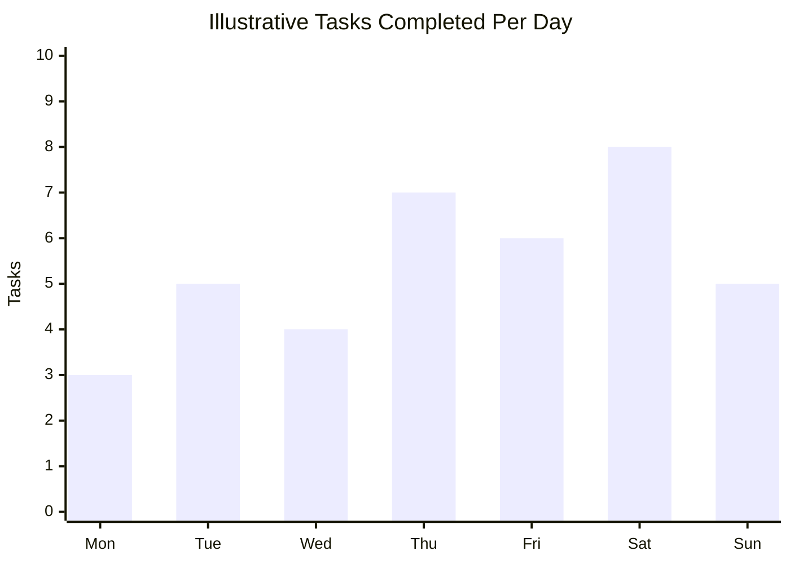
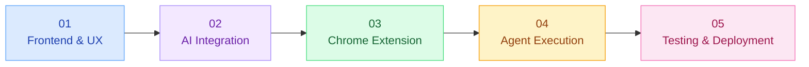

<div align="center">

#  SaarthiFlow

### From Browsing to Doing.

**An Agentic AI Productivity Platform**

*Turning scattered information into structured plans, approved actions, and measurable progress.*


---

**[Overview](#-overview) · [Features](#-core-features) · [Architecture](#-system-architecture) · [Tech Stack](#-technology-stack) · [Setup](#-getting-started) · [Roadmap](#-development-roadmap)**

</div>

## 🌍 Overview

Every day, students, developers, and professionals discover internships, hackathons, events, and opportunities across the internet.

But discovering information is only the beginning.

The real challenge is turning that information into action: extracting deadlines, understanding requirements, planning tasks, and keeping track of everything.

**SaarthiFlow transforms passive browsing into actionable productivity.**

> **Browse → Understand → Plan → Approve → Execute → Verify**

---

## ⚡ The Problem vs. Our Solution

| The Problem | The SaarthiFlow Approach |
|:---|:---|
| Information scattered across websites | Capture relevant webpage context |
| Deadlines are easy to miss | Extract dates and requirements |
| Manual task creation is repetitive | Generate structured action plans |
| AI assistants only provide suggestions | Execute user-approved actions |
| Productivity tools are disconnected | Centralized task workspace |
| Difficult to track automated actions | Maintain execution and activity logs |

---

## ✨ Core Features

| Feature | Description | Module |
|:---|:---|:---|
| 🧠 AI Planning | Convert information into structured action plans | Agent Studio |
| 🌐 Webpage Capture | Extract content from websites | Chrome Extension |
| 📋 Task Management | Create, edit, complete, and organize tasks | My Space |
| ✅ Human Approval | Review actions before execution | Approvals |
| 📅 Deadline Tracking | Organize upcoming deadlines | Calendar |
| 📊 Productivity Insights | Visualize tasks and progress | Analytics |
| 🔍 Execution History | Track actions and verification | Activity |
| ⚡ Quick Actions | Launch common productivity workflows | Quick Actions |

*Features may be in development; see the roadmap for implementation status.*

---

## 🔄 How SaarthiFlow Works



### Example: Discovering a Hackathon

<details>
<summary><b>Click to explore the complete workflow</b></summary>

**Step 1 — Discover**

You open a hackathon registration webpage.

**Step 2 — Capture**

The Chrome extension extracts the event details, deadlines, and requirements.

**Step 3 — Understand**

Gemini identifies important information and generates a structured plan.

**Step 4 — Approve**

You review the proposed tasks and adjust deadlines or priorities.

**Step 5 — Execute**

SaarthiFlow creates the approved tasks in your workspace.

**Step 6 — Verify**

The system confirms the results and records them in the activity log.

</details>

---

## 🏗️ System Architecture



*This diagram shows the target architecture, not necessarily the current implementation.*

---

## 📊 Productivity Analytics

SaarthiFlow's analytics dashboard is designed to visualize:

| Metric | What It Measures |
|:---|:---|
| Active Tasks | Tasks currently in progress |
| Completed Tasks | Successfully finished tasks |
| Completion Rate | Completed tasks as a percentage of all tasks |
| Upcoming Deadlines | Tasks approaching their due dates |
| AI Actions | Agent-generated or executed actions |
| Approval Rate | Approved proposals relative to reviewed proposals |

### Example Task Distribution



*Illustrative data only — not actual SaarthiFlow usage statistics.*

### Example Weekly Productivity



*Sample data used to demonstrate the planned analytics experience.*

---

## 🛠️ Technology Stack

| Layer | Technology | Purpose |
|:---|:---|:---|
| Frontend | React + Vite | Interactive web application |
| Styling | Tailwind CSS | Responsive interface |
| UI Icons | Lucide React | Consistent iconography |
| Charts | Recharts | Productivity visualization |
| AI | Google Gemini API | Information extraction and planning |
| Backend | Node.js + Express | API and action execution |
| Database | Supabase PostgreSQL | Persistent task and activity data |
| Browser | Chrome Manifest V3 | Webpage capture |
| Deployment | Vercel + Render | Frontend and backend hosting |

*Planned stack — update this table to reflect the final repository.*

---

## 🧩 Application Modules

<details>
<summary><b>🏠 Overview Dashboard</b></summary>

- Task and deadline statistics
- Agent Command panel
- Recent agent runs
- Task overview
- Productivity charts

</details>

<details>
<summary><b>🧠 Agent Studio</b></summary>

- Natural-language instructions
- AI-generated action plans
- Task suggestions
- Approval requests
- Agent workflow visualization

</details>

<details>
<summary><b>📋 My Space</b></summary>

- List and Kanban task views
- Project organization
- Priority and deadline management
- Task completion tracking

</details>

<details>
<summary><b>✅ Approvals</b></summary>

- Pending action requests
- Editable task proposals
- Approve or reject actions
- Execution authorization

</details>

<details>
<summary><b>📊 Analytics & Activity</b></summary>

- Productivity metrics
- Completion statistics
- Activity timelines
- Action verification history

</details>

---

## ⚙️ Getting Started

### Prerequisites

- Node.js and npm
- Git
- A modern web browser

### Clone the Repository

```bash
git clone https://github.com/YOUR_USERNAME/SaarthiFlow.git
cd SaarthiFlow
```

### Install Dependencies

```bash
npm install
```

### Run Locally

```bash
npm run dev
```

Open the local URL shown in your terminal.

### Production Build

```bash
npm run build
```

> These commands assume the frontend is at the repository root. Adjust the directory and setup steps to match your actual project.

### Environment Configuration

For backend or AI integration, use an `.env.example` file to document required variables without exposing credentials.

Keep Gemini API keys and database secrets server-side. Never commit `.env` files containing real secrets.

---

## 🗺️ Development Roadmap



### Milestone Checklist

- [ ] **Phase 1:** Frontend, navigation, tasks, and approvals
- [ ] **Phase 2:** Gemini integration and structured AI plans
- [ ] **Phase 3:** Chrome extension and webpage extraction
- [ ] **Phase 4:** Real execution, verification, and activity logs
- [ ] **Phase 5:** Testing, deployment, and final demo

*Update the checkboxes as development progresses.*

---

## 🎯 Target Users

| Audience | Use Case |
|:---|:---|
| Students | Assignments, events, workshops, deadlines |
| Job Seekers | Internship and application tracking |
| Developers | Projects, hackathons, milestones |
| Professionals | Task planning and workflow organization |
| Teams | Shared planning and future collaboration |

---

## 🔮 Future Scope

<details>
<summary><b>Click to explore planned integrations</b></summary>

| Integration | Planned Capability |
|:---|:---|
| Google Calendar | Create and reschedule events |
| Google Tasks | Synchronize tasks |
| Notion | Organize notes and projects |
| Trello | Manage project boards |
| Google Sheets | Update trackers |
| Smart Notifications | Deadline and progress reminders |

</details>

---

## ❓ Frequently Asked Questions

<details>
<summary><b>Is SaarthiFlow just another chatbot?</b></summary>

No. SaarthiFlow is designed to go beyond generating responses by supporting action planning, user approval, task execution, and verification.

</details>

<details>
<summary><b>Does SaarthiFlow perform actions automatically?</b></summary>

The intended workflow requires users to approve proposed actions before execution.

</details>

<details>
<summary><b>Why use a Chrome extension?</b></summary>

It allows SaarthiFlow to capture relevant webpage context without requiring users to manually copy information into the dashboard.

</details>

<details>
<summary><b>Can SaarthiFlow work without external task apps?</b></summary>

Yes. Its internal task manager is designed to create, organize, and track tasks directly within the application.

</details>

---

## 💜 Our Vision

We envision AI systems that do more than understand instructions.

Systems that transform information into organized actions, preserve user control, and make progress visible.

<div align="center">

### SaarthiFlow

**From Browsing to Doing.**

*Discover smarter. Plan better. Get things done.*

</div>
